# Bioacoustic Early Drought-Stress Detection

Detecting drought stress in Solanaceae crops (tomato, tobacco) from **2 ms ultrasonic
emissions recorded at 500 kHz**, using a raw-waveform **1D Convolutional Neural Network**
in TensorFlow/Keras. The pipeline includes in-band SNR noise augmentation and plant-grouped
evaluation.

> Eduvos Data Science Project, Deliverable 4 (Implementation).
> Data: Khait et al. (2023), *Sounds emitted by plants under stress are airborne and informative*,
> Cell 186(7). Dataset DOI: [10.5061/dryad.jwstqjqf7](https://doi.org/10.5061/dryad.jwstqjqf7).

---

## 1. What the pipeline does

| Step | Implementation | Why |
|---|---|---|
| Ingest & validate | SHA-256 manifest of all 5,477 `.wav` files; checks sample rate, length, channels, finiteness, silence, clipping | Audio has no "missing values". Corrupt or wrongly sampled files are the equivalent and are caught before modelling |
| Data versioning | Dataset fingerprint = hash of all file hashes, stored in every run | Any change to the raw audio is detectable; caches are content-addressed |
| Filtering | DC removal + 4th-order **Butterworth band-pass 20-100 kHz**, zero-phase (`sosfiltfilt`) | D1 design; the band holds ~85% of signal power; zero phase keeps the click peak at sample 500 |
| Scaling | Global RMS scaler **fitted on the training split only** | Unit-scale inputs without test leakage; keeps relative loudness |
| Splitting | **Plant-grouped**, class x species stratified 70/15/15 (`StratifiedGroupKFold`) | Clips from one plant are correlated; a clip-level split would leak |
| Imbalance | `class_weight='balanced'` (computed on train) | Drought clips outnumber cut clips 1.6 : 1 |
| Augmentation | On-the-fly mixing with Empty Pot / Greenhouse noise at **random in-band SNR (0-20 dB)**, time-shift, polarity flip | Prepares the model for real greenhouse interference |
| Model | **1D CNN on raw waveform** (1,001 x 1), adapted from the Khait et al. reference architecture | No STFT time-frequency trade-off on a 2 ms transient |
| Baselines | **2D Mel-CNN** and **Mel-LSTM** (the Deliverable 1 proposal), plus a no-augmentation ablation | Measures, rather than asserts, that the redesign is justified |
| Evaluation | Macro-F1, precision, ROC/PR-AUC, MCC; validation-tuned threshold; plant-level bootstrap CIs; per-species; plant-level scores; **SNR robustness sweep** with held-out noise | Honest estimates on a small, clustered dataset |
| Reporting | Static figures + a self-contained `report.html` per run | One-click review for supervisors and growers |

```mermaid
flowchart LR
    A[PlantSounds .wav<br/>5,477 files] --> B[manifest<br/>validate + SHA-256]
    B --> C[decode + cache<br/>keyed by fingerprint]
    C --> D[DC removal +<br/>Butterworth 20-100 kHz]
    D --> E[plant-grouped<br/>representative split]
    E --> F[train-only<br/>scaler + class weights]
    F --> G[tf.data: SNR noise mix,<br/>shift, polarity flip]
    G --> H[1D CNN / 2D Mel-CNN /<br/>Mel-LSTM]
    H --> I[val-tuned threshold,<br/>test metrics + bootstrap CIs,<br/>SNR robustness]
    I --> J[figures, report.html,<br/>model comparison]
```



## 2. Repository layout

```
configs/
  default.yaml                 every tunable parameter (single source of truth)
  experiments/*.yaml           small overrides: cnn1d_aug, cnn1d_noaug, cnn2d_mel_aug, lstm_mel_aug
src/drought_acoustics/
  config.py                    YAML loading, deep-merge, --set overrides, config hashing
  data.py                      manifest, validation, fingerprinting, waveform cache
  preprocessing.py             Butterworth band-pass, AmplitudeScaler
  splitting.py                 plant-grouped stratified holdout / CV, leakage assertion
  augmentation.py              tf.data pipeline, stateless-seeded SNR mixing
  models.py                    cnn1d, cnn2d_mel, lstm_mel, LogMelSpectrogram layer
  training.py                  fit loop, callbacks, class weights
  evaluation.py                metrics, threshold selection, bootstrap, robustness
  visualization.py             EDA and results figures
  reporting.py                 HTML run report
  pipeline.py                  stages: manifest, eda, train, cv, tune, compare
  cli.py                       command-line entry point
tests/                         27 unit tests (pytest)
docs/DECISIONS.md              design decisions, alternatives and evidence
docs/PROGRESS_LOG.md           what was done, why, results so far, critique, how to resume
scripts/run_all.sh             full resumable reproduction
context/CNN_sounds_classifier.py   reference model from Khait et al. (kept unmodified for attribution)
dataset/                       raw audio (not in git, see section 3)
artifacts/                     manifest, data report, EDA, tuning, comparison  (generated)
runs/<timestamp>_<experiment>/ one folder per training run                  (generated)
```

## 3. Reproducing the results

```bash
# 1. Environment (Python 3.10)
python3.10 -m venv .venv && source .venv/bin/activate
pip install -r requirements.txt && pip install -e .

# 2. Data: download PlantSounds from Dryad (DOI above) and place it at
#    dataset/doi_10_5061_dryad_jwstqjqf7__v20230403/PlantSounds/<6 folders>
#    (or point data.raw_dir in configs/default.yaml elsewhere)

# 3. Verify and run
make test          # 27 unit tests
make all           # manifest -> EDA -> tuning -> 4 holdout runs -> 4 x 5-fold CV -> comparison (resumable)
```

Individual stages:

```bash
python -m drought_acoustics.cli manifest
python -m drought_acoustics.cli eda
python -m drought_acoustics.cli tune  -e configs/experiments/cnn1d_aug.yaml
python -m drought_acoustics.cli train -e configs/experiments/cnn1d_aug.yaml
python -m drought_acoustics.cli train -e configs/experiments/cnn1d_aug.yaml --cv
python -m drought_acoustics.cli compare

# override any parameter without editing files, e.g. restrict to tomato (D1 scope):
python -m drought_acoustics.cli train -e configs/experiments/cnn1d_aug.yaml --set "data.species=[tomato]"
```

**Reproducibility guarantees**
- Python, NumPy and TensorFlow are seeded from `project.seed`, with TF op determinism enabled.
- Augmentation uses stateless random ops fed by a seeded `tf.data.Dataset.random` stream, so
  the same config produces the same augmented batches.
- Every run folder stores `config.yaml` (the fully resolved config), `run_info.json` (dataset
  fingerprint, config hash, git commit, package versions), `split_groups.json` (the exact plants
  in each partition), `history.csv`, `model.keras`, `scaler.json`, per-clip predictions,
  `metrics.json`, figures and `report.html`.
- Re-running a saved config: `python -m drought_acoustics.cli train -c runs/<run>/config.yaml`.

## 4. Results

> **Provisional (session 1).** CV for the baseline models is still running. See
> `docs/PROGRESS_LOG.md` for the full status and `artifacts/comparison/` for figures.

**5-fold plant-grouped cross-validation (primary estimate)**

| Model | ROC-AUC (mean ± sd) | Macro-F1 (mean ± sd) | Pooled OOF ROC-AUC [95% CI] |
|---|---|---|---|
| 1D CNN + augmentation (proposed, tuned) | 0.781 ± 0.047 | 0.695 ± 0.038 | 0.767 [0.70–0.82] |
| 2D Mel-CNN + augmentation (D1) | *running* | | |
| Mel-LSTM + augmentation (D1) | *queued* | | |
| 1D CNN, no augmentation | *queued* | | |

**Holdout test set** (550 clips, 26 plants never seen in training; threshold chosen on validation)

| Model | Macro-F1 | ROC-AUC [95% CI] | ROC-AUC at 0 dB SNR | at −5 dB |
|---|---|---|---|---|
| 1D CNN + aug (proposed) | 0.644 | 0.692 [0.53–0.85] | 0.657 | 0.640 |
| 1D CNN, no aug | 0.616 | 0.662 [0.51–0.82] | 0.613 | 0.597 |
| 2D Mel-CNN + aug (D1) | 0.671 | 0.728 [0.53–0.86] | 0.708 | 0.648 |
| Mel-LSTM + aug (D1) | 0.594 | 0.649 [0.52–0.79] | 0.634 | 0.645 |
| Majority-class baseline | 0.379 | 0.500 | – | – |

All models beat the baseline. Augmentation improves robustness to held-out noise. The holdout
alone cannot separate the architectures: the CIs overlap and span about 0.3 AUC, which is why the
paired CV comparison is the deciding evidence.

## 5. Limitations

- The dataset contains **one recording per click with no timestamps** relative to wilting, so the
  Deliverable 1 lead-time metric (Δt = t_wilt - t_alert) cannot be computed from it. The same
  applies to the three-level severity scale (healthy / minor / severe): the labels are binary
  (cut vs dry).
- The noise recordings come from **one Empty Pot session and four greenhouse sessions**, so
  train and test noise are different files but not fully independent sessions.
- Species and class are partly confounded (tomato makes up 86% of drought clips), so results are
  reported per species.

## 6. Attribution

The 1D CNN block structure follows the reference implementation released with Khait et al. (2023)
(`context/CNN_sounds_classifier.py`, kept unmodified). Everything else in this repository was
written for this project: data validation and versioning, preprocessing, plant-grouped splitting,
SNR augmentation, baselines, evaluation, visualisation, reporting and tests.
